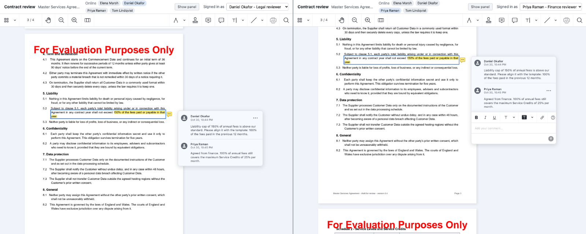
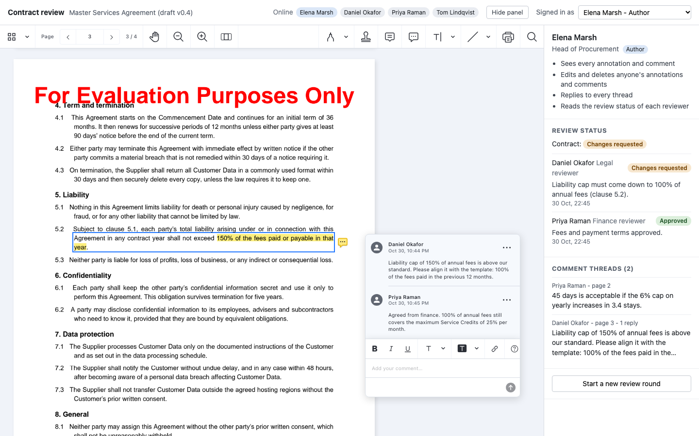
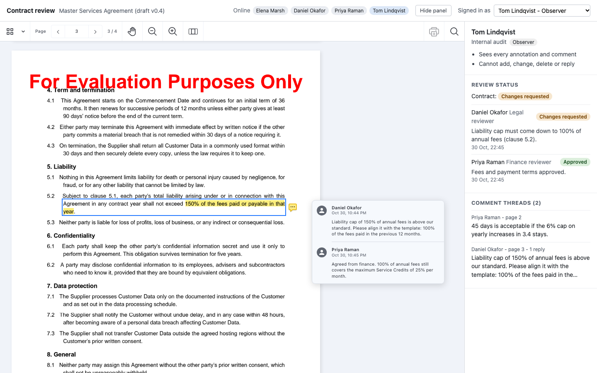

# Nutrient Real-Time Contract Review

A Nutrient.io demo in which an author, two reviewers and an observer open the same contract in their own browsers, see each other's annotations and comment threads appear live, and can only do what their role allows, enforced by Nutrient Document Engine.



1. **Document.** Document Engine stores the contract. On its first start, the Node server uploads `documents/master-services-agreement.pdf`.
2. **Sign-in.** The user picks who they are. The server signs a JWT for that user with their `user_id`, their document `permissions` and their Document Engine `collaboration_permissions`.
3. **Live sync.** The Nutrient Web SDK opens the document from Document Engine with `instant: true`. Every annotation, comment and reply is saved to Document Engine and pushed to every other browser that has the document open, without a reload. The top bar lists who is online (`instance.connectedClients`).
4. **Permissions.** Document Engine applies the permissions of the JWT to every user. The viewer reads them on each record (`isEditable`, `isDeletable`, `canReply`) and hides what the user cannot do. A change the user is not allowed to make is refused by Document Engine (HTTP 403) and never reaches the other browsers.
5. **Comment threads.** A reviewer selects a passage and comments on it, or drops a comment marker. The thread opens beside the page. The side panel lists every thread with its author, page and number of replies.
6. **Review status.** Each reviewer approves the contract or requests changes, with an optional note. The server checks the JWT, saves the status in `data/reviews.json` and pushes it to every browser with server-sent events. The contract is **Changes requested** as soon as one reviewer asks for changes, and **Approved** when every reviewer has approved.

Annotations and comments never pass through the Node server. The browsers sync them with Document Engine directly.

## Users and permissions

All four users are fictitious.

| User | Role | JWT `permissions` | JWT `collaboration_permissions` |
|---|---|---|---|
| Elena Marsh | Author | `read-document`, `write`, `download` | `annotations:view:all`, `annotations:edit:all`, `annotations:delete:all`, `comments:view:all`, `comments:edit:all`, `comments:delete:all`, `comments:reply:all` |
| Daniel Okafor | Legal reviewer | `read-document`, `write` | `annotations:view:all`, `annotations:edit:self`, `annotations:delete:self`, `comments:view:all`, `comments:edit:self`, `comments:delete:self`, `comments:reply:all` |
| Priya Raman | Finance reviewer | same as the legal reviewer | same as the legal reviewer |
| Tom Lindqvist | Observer | `read-document` | `annotations:view:all`, `comments:view:all` |

`write` is what allows a user to create annotations and comments at all. Collaboration permissions then decide what a user may do with existing records: `self` means records the user created, identified by the `user_id` of the JWT. Anything that is not listed is denied. The roles are defined in `server/server.js` (`ROLES` and `USERS`).

## Prerequisites

- Docker Desktop with at least 4 GB of memory
- Node.js 22 or later and npm
- OpenSSL and a POSIX shell, to generate the local keys (on Windows, use Git Bash or WSL)
- Free ports 4310 (app) and 5310 (Document Engine), or other ports set in `.env`
- Internet access: the browser loads Nutrient Web SDK 1.24.0 from the Nutrient CDN
- Python 3.10 or later, only to regenerate the sample contract

## Environment variables

Copy `.env.example` to `.env`. Docker Compose and the Node server read it. License keys are only read from environment variables, never from code.

| Variable | Purpose | Default |
|---|---|---|
| `ACTIVATION_KEY` | Document Engine activation key or offline license key | empty = evaluation mode |
| `WEB_SDK_LICENSE_KEY` | Web SDK license key, sent to the browser by `POST /api/session` | empty = evaluation mode |
| `POSTGRES_PASSWORD` | Local PostgreSQL password used by Document Engine | `change-me`, change it |
| `DASHBOARD_PASSWORD` | Document Engine dashboard password (<http://localhost:5310/dashboard>, user `dashboard`) | `change-me`, change it |
| `APP_PORT` | Port of the Node server | `4310` |
| `DOCUMENT_ENGINE_PORT` | Host port of Document Engine. The browsers connect to it for the live sync | `5310` |

In evaluation mode, Document Engine shows a watermark on every page. Everything else works, including Instant comments, which need their own license component in production.

`scripts/generate-keys.sh` writes the other secrets to `keys/`, which is not committed:

| File | Content |
|---|---|
| `keys/jwt-private.pem` | RSA key the server uses to sign the user JWTs |
| `keys/jwt-public.pem` | Matching public key. The server also uses it to check the JWT sent with a review status |
| `keys/document-engine.env` | `JWT_PUBLIC_KEY`, `API_AUTH_TOKEN` and `SECRET_KEY_BASE` for Document Engine |
| `keys/app.env` | `DE_API_TOKEN` for the Node server, the same value as `API_AUTH_TOKEN` |

## Build and run

```bash
cp .env.example .env
```

```bash
./scripts/generate-keys.sh
```

```bash
docker compose up -d
```

```bash
cd server
```

```bash
npm install
```

```bash
npm start
```

Open <http://localhost:4310>. Then open a second browser window, or a private window, and pick another user. The user is kept in the URL (`?user=priya`), so each window can be a different user.

To stop and remove the containers and the database:

```bash
docker compose down -v
```

## Using the app

1. **Pick a user** in **Signed in as**. The panel on the right shows the user's role and what the role allows.
2. **Comment.** Select a passage, then choose **Comment** in the toolbar that appears, type and press **Save**. Or pick the comment tool in the main toolbar and click on the page. The thread appears at once in every other window and in **Comment threads**.
3. **Reply.** Click a thread in **Comment threads** (or its marker on the page), type in **Add your comment** and press **Save**. Every user except the observer can reply.
4. **Review.** A reviewer writes an optional note and clicks **Approve** or **Request changes**. The status changes in every window at once. The author sees each reviewer's status and the status of the contract.

   

5. **Observer.** The observer sees every annotation and thread, but has no annotation tools, no reply box and no review buttons.

   

6. **New round.** The author's **Start a new review round** deletes every annotation and comment and sets every review back to **Pending**.

**Hide panel** gives the document the whole width.

## Live sync test

`tests/live-sync.mjs` opens each user in its own Playwright browser context (separate storage, like separate computers) and checks the whole flow. The app and Document Engine must be running. The test starts a new review round first, so it deletes the annotations on the document.

```bash
cd tests
```

```bash
npm install
```

```bash
npx playwright install chromium
```

```bash
npm test
```

It runs 22 checks. On a laptop with everything local, a thread saved in one browser showed up in the other one 15 to 20 ms later, and a reply 50 to 60 ms later.

| Check | Result |
|---|---|
| A thread started by the legal reviewer appears in the finance reviewer's browser and thread list | live, no reload |
| A reply typed in the finance reviewer's comment editor appears in the legal reviewer's browser, with her name | live |
| A thread started by the finance reviewer appears in the legal reviewer's browser | live |
| A reviewer cannot edit or delete the other reviewer's highlight, but can reply. Both attempts are refused | `isEditable: false`, `isDeletable: false`, `canReply: true` |
| A reviewer can edit and delete their own highlight | `isEditable: true`, `isDeletable: true` |
| The observer sees the thread, cannot reply, edit or delete | `canReply: false` |
| A note the observer creates through the API is refused by Document Engine, never reaches the author and is gone after a reload | HTTP 403 on push |
| The author can edit, delete and reply to everything | all `true` |
| Request for changes and approval appear in the other reviewers' browsers; the author sees **Changes requested** | live, server-sent events |
| The server refuses a review status from the observer | HTTP 403 |

`npm run screenshots` runs the same checks and writes the images in `docs/screenshots/`.

## API

| Method and path | Description |
|---|---|
| `GET /api/users` | The demo users with their role and what the role allows, and the document title |
| `POST /api/session` | Body `{ "userId": "daniel" }`. Returns the Document Engine URL, the document id, the user's JWT (8 hours) and the Web SDK license key |
| `GET /api/reviews` | The status of each reviewer and of the contract |
| `PUT /api/reviews/me` | Body `{ "status": "approved" \| "changes_requested" \| "pending", "note": "..." }` with `Authorization: Bearer <JWT>`. Reviewers only |
| `GET /api/reviews/stream` | Server-sent events: the review status, each time it changes |
| `POST /api/reset` | With the author's JWT. Deletes every annotation (and the comments attached to them) and resets the reviews |

## Samples

`documents/master-services-agreement.pdf` is a fictitious 4-page master services agreement. Every company, person, address and figure in it is invented. To regenerate it:

```bash
pip install -r samples/requirements.txt
```

```bash
python samples/generate_contract.py
```

After regenerating, run `docker compose down -v` so that the server uploads the new version.

## Limitations

- The user picker stands in for a real sign-in: anyone who can reach the server can get a JWT for any demo user. A real application signs the JWT after its own authentication.
- The review status of one document is kept in a JSON file. A real application keeps it in its database, per document and per review round.
- The display name on annotations and comments is set by the browser (`setAnnotationCreatorName`). Permissions do not rely on it: Document Engine uses the `user_id` of the JWT.
- The Web SDK refuses a reviewer's change to another reviewer's annotation before sending it, using the permissions Document Engine sends. The test checks this refusal in the viewer. The refusal by Document Engine itself is checked with the observer, whose changes are sent and rejected with HTTP 403.

## Files

| Path | Content |
|---|---|
| `server/server.js` | Roles and users, JWT signing, document upload, review status API and server-sent events |
| `web/` | User picker, Web SDK viewer, review panel and thread list |
| `tests/live-sync.mjs` | Multi-browser live sync and permission checks with Playwright, and the screenshots |
| `docker-compose.yml` | Document Engine 1.20.0 and PostgreSQL |
| `scripts/generate-keys.sh` | JWT key pair and API token for the local setup |
| `documents/` | The sample contract |
| `samples/` | The contract generator |
